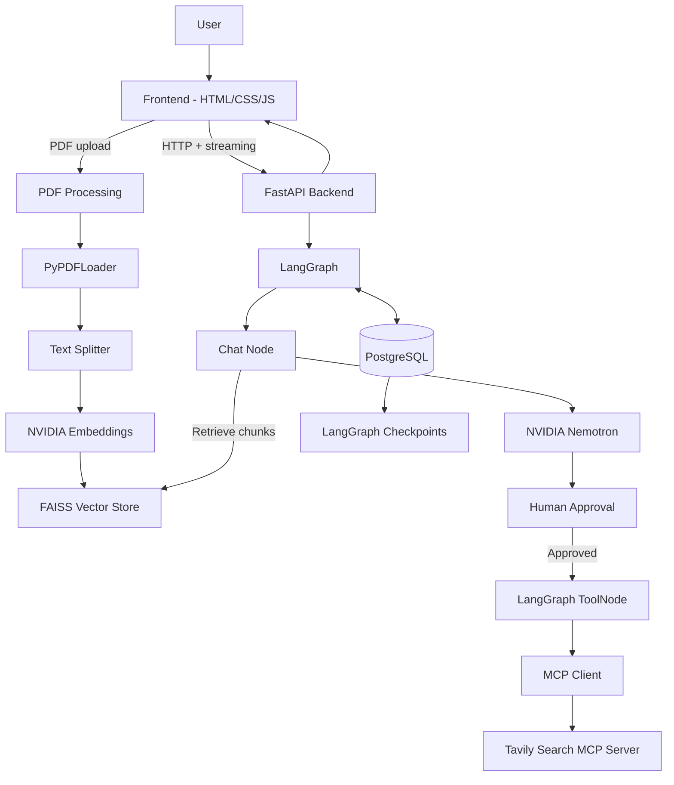

# 🧠 SYNAPSE AI

## 🌐 Live Demo

🚀 **Try SYNAPSE AI:** [Click here to use SYNAPSE AI](https://synapse-ai-frontend-e4macl94o-sinhapushkar047.vercel.app/)

Experience the live chatbot directly in your browser.

> An AI chatbot combining **NVIDIA Nemotron, MCP web search, PDF-based RAG, and human-approved tool execution**.

SYNAPSE AI uses FastAPI and LangGraph to coordinate conversations, retrieve information from uploaded PDFs, and call web-search tools through an MCP server.

## ✨ Features

- 🤖 **AI chat** powered by NVIDIA Nemotron.
- 🌐 **Web search** through a Tavily Search MCP server.
- 📄 **PDF RAG** — upload PDFs and ask questions about their contents.
- 🔎 **Context retrieval** using NVIDIA embeddings and FAISS.
- 🔀 **PDF + web fallback** — use PDF context first and web search when needed.
- 🛡️ **Human-in-the-loop approval** before executing MCP tool calls.
- ⚡ **Streaming responses** from the FastAPI backend.
- 🧵 **Conversation threads** managed through LangGraph and PostgreSQL checkpoints.
- 💬 **Chat interface** with Markdown rendering and PDF upload support.

## 🏗️ Architecture



### 🔄 Request flow

1. The frontend sends a message and thread ID to FastAPI.
2. LangGraph runs the chat workflow.
3. Relevant PDF chunks are retrieved from FAISS when PDFs are uploaded for that thread.
4. Nemotron generates a response or requests an MCP tool.
5. If a tool is requested, the workflow pauses for user approval.
6. Approved tool calls run through the MCP server.
7. The response is streamed back to the frontend, while LangGraph checkpoints the workflow in PostgreSQL.

## 🧰 Tech Stack

| Layer | Technology |
|---|---|
| Frontend | HTML, CSS, JavaScript |
| Markdown / sanitization | Marked.js, DOMPurify |
| Backend | FastAPI |
| Orchestration | LangGraph, LangChain |
| LLM | NVIDIA Nemotron |
| Embeddings | `nvidia/nemotron-3-embed-1b` |
| MCP integration | `langchain-mcp-adapters` |
| Web search | Tavily Search MCP |
| PDF processing | PyPDFLoader, RecursiveCharacterTextSplitter |
| Vector store | FAISS |
| Checkpoint storage | PostgreSQL, `PostgresSaver`, Psycopg |

## 📚 PDF RAG

The current PDF pipeline:

1. Extract text using `PyPDFLoader`.
2. Split text into chunks (`chunk_size=900`, `chunk_overlap=150`).
3. Generate embeddings using NVIDIA's embedding model.
4. Store vectors in FAISS.
5. Retrieve the top 4 relevant chunks for a question.
6. Pass the retrieved context to the LLM.

**Storage detail:** FAISS indexes are currently held in backend memory and keyed by thread ID. They are not stored in PostgreSQL, so they are lost when the backend restarts and are not shared across multiple backend instances.

## 🌐 MCP Web Search & Approval

The backend connects to a Tavily Search MCP server over HTTP. When the model requests a tool, LangGraph pauses at an approval step. The user can approve or reject the request before execution.

The MCP server must be reachable by the deployed backend. A server running at `127.0.0.1` on a developer's laptop is only available locally; it cannot be reached by a backend hosted on Render.

## ☁️ Deployment

The deployment target is:

| Component | Deployment target |
|---|---|
| Frontend | Vercel |
| FastAPI backend | Render |
| Tavily Search MCP server | Render (separate service) |
| PostgreSQL | Hosted PostgreSQL for production; Docker PostgreSQL for local development |

### 🚀 Deployment overview

1. **Push the project to GitHub.** Keep API keys, passwords, and `.env` files out of the repository.
2. **Deploy the MCP server to Render.** Configure its Tavily API key as a Render environment variable and expose its HTTP MCP endpoint.
3. **Deploy the FastAPI backend to Render.** Set the backend's environment variables and configure it to connect to the deployed MCP endpoint and hosted PostgreSQL database.
4. **Deploy the frontend to Vercel.** Update the frontend API base URL to the public Render backend URL.
5. **Configure CORS.** Allow requests from the deployed frontend domain.
6. **Test the full flow** after deployment: chat, streaming, PDF upload and retrieval, MCP approval, web search, and database checkpointing.

### 🔐 Production environment configuration

Configure secrets in the hosting provider's environment-variable settings, not in frontend code or GitHub.

| Variable / setting | Used for |
|---|---|
| `NVIDIA_API_KEY` | NVIDIA LLM and embedding access |
| `TAVILY_API_KEY` | Tavily Search MCP server |
| PostgreSQL credentials / connection URL | Backend database connection |
| MCP endpoint URL | URL of the deployed MCP server |
| Frontend API base URL | Public FastAPI backend URL |
| CORS allowed origin | Deployed frontend domain |

The exact variable names must match the backend and MCP server code. The supplied backend currently builds its PostgreSQL connection using `localhost:5432` and `POSTGRES_USER`, `POSTGRES_PASSWORD`, and `POSTGRES_DB`. Before deploying, update the database configuration to use the hosted PostgreSQL connection details. Likewise, replace the hard-coded local MCP URL and frontend API URL with the deployed service URLs (preferably configured through environment variables).

### 🐘 PostgreSQL: local vs production

Docker PostgreSQL is suitable for local development:

```bash
docker compose up -d
```

A Render-hosted backend cannot connect to PostgreSQL running on `localhost` or inside Docker on your personal computer. For deployment, use a hosted PostgreSQL instance and configure the backend with its connection details. Keep Docker Compose for local development.

### ⚠️ Deployment considerations

- **FAISS persistence:** PDF indexes are currently in memory. Uploaded PDF indexes will be lost on backend restart. A persistent/shared vector-storage solution is needed if uploaded documents must remain available after restarts or across instances.
- **Session cleanup:** PostgreSQL LangGraph checkpoints and browser `localStorage` are separate. The current implementation does not automatically delete both when a browser session ends. If the deployed app must have session-only conversations, implement and test cleanup for server-side checkpoints and client-side session data.
- **MCP networking:** Use the public/reachable MCP service URL in the Render backend, not `127.0.0.1`.
- **CORS:** Restrict allowed origins to the Vercel frontend domain in production.
- **Secrets:** Never expose NVIDIA, Tavily, or database credentials in frontend code or commit them to GitHub.

## 📁 Project Structure

```text
SYNAPSE-AI/
├── backend/
│   ├── api.py
│   └── requirements.txt
├── mcp-server/
│   └── ...                 # Tavily Search MCP server
├── frontend/
│   └── index.html
├── docker-compose.yml      # Local PostgreSQL
├── .gitignore
└── README.md
```

Adjust the paths to match the actual repository layout.

## 🛠️ Local Development

### Prerequisites

- Python 3.10+
- Docker Desktop
- NVIDIA API key
- Tavily API key
- Git

### 1. Clone the repository

```bash
git clone <YOUR_GITHUB_REPOSITORY_URL>
cd SYNAPSE-AI
```

### 2. Start PostgreSQL locally

Create a `docker-compose.yml` file:

```yaml
services:
  postgres:
    image: postgres:16
    container_name: synapse-postgres
    restart: unless-stopped
    environment:
      POSTGRES_USER: synapse
      POSTGRES_PASSWORD: change_this_password
      POSTGRES_DB: synapse_db
    ports:
      - "5432:5432"
    volumes:
      - synapse_postgres_data:/var/lib/postgresql/data

volumes:
  synapse_postgres_data:
```

Start it:

```bash
docker compose up -d
```

### 3. Configure the backend

Create a `.env` file in the backend directory:

```env
NVIDIA_API_KEY=your_nvidia_api_key
TAVILY_API_KEY=your_tavily_api_key

POSTGRES_USER=synapse
POSTGRES_PASSWORD=change_this_password
POSTGRES_DB=synapse_db
```

Do not commit this file.

### 4. Install backend dependencies

```bash
cd backend
python -m venv venv
```

Activate the environment.

**Windows PowerShell:**

```powershell
.\venv\Scripts\Activate.ps1
```

**Linux/macOS:**

```bash
source venv/bin/activate
```

Install the packages:

```bash
pip install fastapi uvicorn python-dotenv python-multipart
pip install langchain langgraph langchain-core langchain-community
pip install langchain-nvidia-ai-endpoints langchain-mcp-adapters
pip install langgraph-checkpoint-postgres psycopg psycopg-pool
pip install pypdf faiss-cpu langchain-text-splitters
```

Run the backend (adjust `api:app` if your filename or app variable differs):

```bash
uvicorn api:app --reload --host 0.0.0.0 --port 8000
```

Backend health check:

```text
http://127.0.0.1:8000/
```

### 5. Run the MCP server

Start the Tavily Search MCP server separately and make sure its HTTP endpoint matches the URL configured in the backend. For local development, the supplied backend currently expects:

```text
http://127.0.0.1:8001/mcp
```

### 6. Run the frontend

Open `frontend/index.html` in a browser or serve it with a local static server. Make sure its API base URL points to:

```text
http://127.0.0.1:8000
```

## 🔌 API Endpoints

| Method | Endpoint | Purpose |
|---|---|---|
| `GET` | `/` | Backend health check |
| `GET` | `/Conversation` | Stream a conversation response |
| `POST` | `/UploadPDF` | Upload one or more PDFs for a thread |
| `GET` | `/Approve` | Approve or reject a pending MCP tool call |

### 💬 Conversation

Send the user message as the `user_input` query parameter and the thread ID in the `thread-id` header.

```http
GET /Conversation?user_input=Explain%20RAG
thread-id: your-thread-id
```

The response is streamed as plain text. The backend returns the active thread ID in the `X-Thread-ID` response header.

### 📄 PDF upload

Send a multipart form-data request to `/UploadPDF`:

- Form field: `files` (one or more PDF files)
- Header: `thread-id`

### ✅ Tool approval

Resume a paused workflow through `/Approve`:

```http
GET /Approve?approved=true
thread-id: your-thread-id
```

Use `approved=false` to reject the tool call.

## 🖼️ Screenshots


## 📝 Notes

- PostgreSQL stores LangGraph checkpoints; it does not store the FAISS indexes.
- The frontend currently stores chat-session display data in browser `localStorage`.
- The current backend uses synchronous LangGraph streaming and a synchronous PostgreSQL connection pool.
- Verify all service URLs, environment variables, CORS settings, and storage behavior before making the deployed app public.
